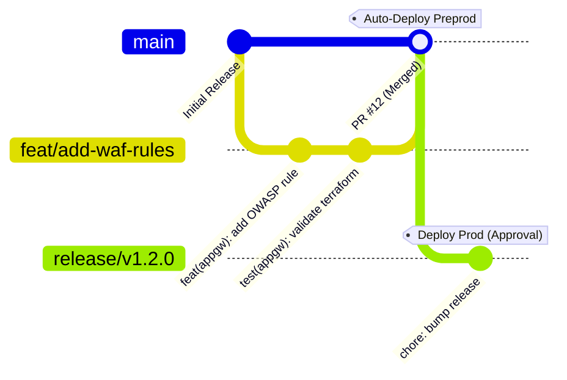

# Enterprise Infrastructure Contributing Guidelines

Welcome to the **Enterprise Azure Terraform Infrastructure** repository. To maintain high availability, strict security compliance, and code quality across production and pre-production environments, all contributors must adhere to the following standards.

---

## 1. Git Workflow & Branching Strategy

We follow a **Trunk-Based Development** model with short-lived feature branches:



- **Branch Naming Conventions**:
  - `feat/<short-description>`: New Terraform modules or resource capabilities.
  - `fix/<short-description>`: Bug fixes or misconfiguration remediation.
  - `security/<short-description>`: Urgent security patches or vulnerability remediation.
  - `refactor/<short-description>`: Code cleanup without functional changes.
  - `chore/<short-description>`: Dependency updates, CI/CD pipeline tweaks.

---

## 2. Commit Message Standards (Conventional Commits)

All commit messages must adhere to the [Conventional Commits v1.0.0](https://www.conventionalcommits.org/) specification:

```text
<type>(<scope>): <short description in imperative mood>

[optional body describing the motivation, architectural changes, or blast radius]

[optional footer(s) such as Closes #123, BREAKING CHANGE: ...]
```

### Allowed Types:
- `feat`: Addition of new resources or variable exposures.
- `fix`: Fixes for state drifts, broken dependencies, or syntax errors.
- `docs`: Documentation updates (README, diagrams, architecture docs).
- `ci`: Changes to GitHub Actions or Azure DevOps pipelines.
- `security`: Security rule hardening (NSG, Key Vault policies, WAF rules).
- `test`: Automated validation scripts or terraform unit tests.

### Examples:
- `feat(modules/appgw): enable WAF v2 prevention mode`
- `fix(environments/prod): correct backend subnet CIDR allocation`
- `security(keyvault): enforce minimum TLS 1.2 and purge protection`

---

## 3. Local Development & Pre-Commit Quality Checks

Before pushing any branch or submitting a pull request, run the following automated checks:

### 1. Format Code
```bash
terraform fmt -recursive
```

### 2. Linting with TFLint
```bash
tflint --init
tflint --recursive
```

### 3. Security Scanning
```bash
# Check for hardcoded secrets
gitleaks detect --verbose

# Scan for IaC misconfigurations
tfsec ./environments/preprod
```

### 4. Terraform Validation
```bash
cd environments/preprod
terraform init -backend=false
terraform validate
```

---

## 4. Pull Request Requirements

When creating a Pull Request:
1. Complete all sections of the [Pull Request Template](.github/pull_request_template.md).
2. Ensure automated CI checks pass:
   - `Terraform Format & Validate`
   - `TFLint Best Practices`
   - `Gitleaks & Security Scans`
   - `Speculative Plan generation`
3. Request review from required code owners specified in [CODEOWNERS](.github/CODEOWNERS).
4. Any change modifying network security groups (NSGs), public IPs, or Key Vaults requires sign-off from the Cloud Security Lead.

---

## 5. Environment Promotion Protocol

1. **Pre-Production (`preprod`)**:
   - Merges to `main` automatically trigger `terraform plan` followed by `terraform apply` in `preprod`.
   - Verification tests and health probes execute automatically.
2. **Production (`prod`)**:
   - Promotion to `prod` requires explicit sign-off via **GitHub Environments Protection Rules**.
   - Deployment windows: Tuesday – Thursday, 10:00 AM – 4:00 PM UTC.
