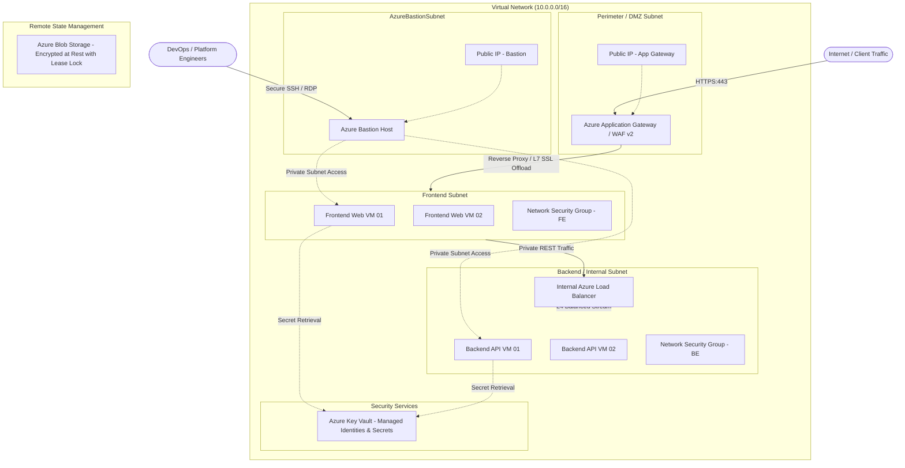

<div align="center">

# ☁️ Enterprise Multi-Tier Azure Infrastructure with Terraform & GitOps CI/CD

[](https://www.terraform.io/)
[](https://azure.microsoft.com/)
[](.github/workflows/terraform-ci-cd.yml)
[](SECURITY.md)
[](LICENSE)

<p align="center">
  <b>A production-hardened, zero-trust reference architecture provisioning multi-tier cloud infrastructure in Microsoft Azure using reusable Terraform modules and automated via GitOps with Azure OIDC passwordless authentication.</b>
</p>

</div>

---

## 📑 Table of Contents
- [Architecture Overview](#-architecture-overview)
- [Enterprise Features](#-enterprise-features)
- [Repository Structure](#-repository-structure)
- [Terraform Module Catalog](#-terraform-module-catalog)
- [Multi-Environment Strategy](#-multi-environment-strategy)
- [GitOps CI/CD & Security Workflow](#-gitops-cicd--security-workflow)
- [Prerequisites & Quickstart](#-prerequisites--quickstart)
- [Azure OIDC Setup](#-azure-oidc-federated-identity-setup)
- [Governance & Compliance](#-governance--compliance)

---

## 🏛️ Architecture Overview

The infrastructure deploys a secure, segmented, multi-tier cloud topology following Microsoft Azure Well-Architected Framework guidelines:



---

## 🚀 Enterprise Features

- **Zero-Trust Network Segmentation**: Workloads reside in dedicated subnets isolated by granular Network Security Groups (NSGs). Direct public access to compute nodes is strictly disabled.
- **Enterprise Edge Security**: Azure Application Gateway v2 provides Layer-7 SSL termination, health probe monitoring, and OWASP rule inspection.
- **Secure Operator Access**: Zero exposed SSH/RDP ports. Azure Bastion provides secure, browser-based TLS management into private VMs.
- **Automated Secrets Protection**: Azure Key Vault handles cryptographic keys and VM administrative credentials with soft-delete and purge protection enabled.
- **Passwordless GitOps CI/CD**: Eliminates long-lived service principal client secrets by utilizing **GitHub Actions Azure OIDC (Federated Identity Credentials)**.
- **Automated Guardrails**: Enforces pre-commit checks, Gitleaks secret interception, TFLint linting, and Trivy/tfsec security scans before any code merges to `main`.
- **Environment Parity**: Complete separation of state, secrets, and configurations between `preprod` and `prod`.

---

## 📁 Repository Structure

```text
├── .github/
│   ├── workflows/
│   │   └── terraform-ci-cd.yml      # Enterprise 4-stage GitHub Actions CI/CD with OIDC
│   ├── ISSUE_TEMPLATE/
│   │   ├── bug_report.yml           # Structured issue reporting
│   │   ├── infrastructure_change.yml# RFC / Change request template
│   │   └── config.yml               # Blank issue restrictions
│   ├── CODEOWNERS                   # Granular review assignments
│   ├── dependabot.yml               # Automated daily/weekly dependency audits
│   └── pull_request_template.md     # Blast-radius & security verification template
├── environments/
│   ├── preprod/                     # Pre-Production environment configuration
│   │   ├── main.tf                  # Module orchestrations
│   │   ├── provider.tf              # Provider & Remote state backend
│   │   ├── terraform.tfvars         # Preprod variable assignments
│   │   └── variables.tf             # Input variable declarations
│   └── prod/                        # Production environment configuration
│       ├── main.tf                  # Production module orchestrations
│       ├── provider.tf              # Production isolated state backend
│       ├── terraform.tfvars         # Production variable assignments
│       └── variables.tf             # Production variable declarations
├── modules/                         # Reusable, encapsulated Terraform modules
│   ├── azurerm_application_gateway/ # L7 WAF Application Gateway
│   ├── azurerm_bastion/             # Secure Azure Bastion management
│   ├── azurerm_key_vault/           # Key Vault & Access Policies
│   ├── azurerm_load_balancer/       # Internal L4 Load Balancer
│   ├── azurerm_network_interface/   # NIC definitions & IP configurations
│   ├── azurerm_network_security_group/ # NSG ingress/egress rules
│   ├── azurerm_public_ip/           # Standard SKU Static Public IPs
│   ├── azurerm_resource_group/      # Resource Group governance
│   ├── azurerm_subnet/              # Subnet CIDR carving & delegations
│   ├── azurerm_virtual_machine/     # Compute instances (Linux/Windows)
│   └── azurerm_virtual_network/     # VNet backbone
├── .gitignore                       # Enterprise Terraform ignore rules
├── .pre-commit-config.yaml          # Developer pre-commit hooks
├── azure-pipelines.yml              # Azure DevOps pipeline alternative
├── CONTRIBUTING.md                  # Development guidelines & GitFlow
├── LICENSE                          # MIT License
├── SECURITY.md                      # Vulnerability reporting & SLA policy
└── README.md                        # Master repository documentation
```

---

## 🧩 Terraform Module Catalog

Each module in `modules/` is designed for composability, reusability, and immutability:

| Module | Purpose | Key Azure Resources Provisioned |
| :--- | :--- | :--- |
| `azurerm_resource_group` | Lifecycle container & tagging governance | `azurerm_resource_group` |
| `azurerm_virtual_network` | High-bandwidth isolated cloud network | `azurerm_virtual_network` |
| `azurerm_subnet` | Subnet tier partitioning (FE, BE, Bastion) | `azurerm_subnet` |
| `azurerm_public_ip` | Static public egress/ingress points | `azurerm_public_ip` (Standard SKU) |
| `azurerm_bastion` | Secure jumpbox service for private VMs | `azurerm_bastion_host` |
| `azurerm_application_gateway` | L7 routing, SSL termination, and WAF | `azurerm_application_gateway` |
| `azurerm_load_balancer` | Internal L4 traffic distribution for tiering | `azurerm_lb`, `azurerm_lb_backend_address_pool` |
| `azurerm_virtual_machine` | Linux/Windows application hosts | `azurerm_linux_virtual_machine` |
| `azurerm_network_security_group` | Micro-segmentation firewall rules | `azurerm_network_security_group` |
| `azurerm_key_vault` | Hardware-backed secrets & certificate storage | `azurerm_key_vault` |

---

## 🔄 Multi-Environment Strategy

```text
[ Developer Branch ] ──> [ PR to main ]
                             │
                             ├──> Speculative Plan posted to PR
                             ├──> TFLint & Gitleaks Checks
                             │
[ Merge to main ] ───────────┴──> Auto-Deploy to [ Preprod ]
                                      │
                                  Verification Tests
                                      │
                                 [ Production ] (Approval Gate Required)
```

1. **State Isolation**: Separate Azure Storage Containers and state files are maintained per environment (`preprod` and `prod`).
2. **Blast Radius Control**: Developers cannot apply to production directly from local workstations.
3. **Approval Gates**: Deployments to the `production` environment require manual sign-off from designated Cloud Platform Leads via GitHub Environment Protection Rules.

---

## 🛠️ Prerequisites & Quickstart

### Prerequisites
- [Terraform CLI](https://developer.hashicorp.com/terraform/downloads) (>= 1.9.0)
- [Azure CLI](https://docs.microsoft.com/en-us/cli/azure/install-azure-cli) (`az` >= 2.60.0)
- [TFLint](https://github.com/terraform-linters/tflint) & [Gitleaks](https://github.com/gitleaks/gitleaks)

### Local Validation
```bash
# 1. Clone repository
git clone https://github.com/avinashkean-cpu/azure-enterprise-terraform-infrastructure.git
cd azure-enterprise-terraform-infrastructure

# 2. Login to Azure
az login

# 3. Change directory to targeted environment
cd environments/preprod

# 4. Initialize Terraform with remote backend
terraform init

# 5. Format and Validate
terraform fmt -check
terraform validate

# 6. Execute Speculative Plan
terraform plan
```

---

## 🔐 Azure OIDC Federated Identity Setup

To enable passwordless authentication between GitHub Actions and your Azure tenant:

1. **Create an Azure Entra App Registration**:
   ```bash
   az ad app create --display-name "github-actions-terraform"
   ```
2. **Add Federated Credential for GitHub Actions**:
   - **Issuer**: `https://token.actions.githubusercontent.com`
   - **Subject**: `repo:avinashkean-cpu/azure-enterprise-terraform-infrastructure:ref:refs/heads/main`
   - **Audience**: `api://AzureADTokenExchange`
3. **Configure Repository Secrets in GitHub**:
   - `AZURE_CLIENT_ID`: Application (Client) ID of the Entra App
   - `AZURE_TENANT_ID`: Azure Active Directory Directory (Tenant) ID
   - `AZURE_SUBSCRIPTION_ID`: Azure Subscription ID

---

## 🛡️ Governance & Security Standards

- **Code Reviews**: Enforced via [CODEOWNERS](.github/CODEOWNERS).
- **Security Inquiries**: Detailed in [SECURITY.md](SECURITY.md).
- **Contribution Standards**: Detailed in [CONTRIBUTING.md](CONTRIBUTING.md).
- **Dependency Automation**: Automated via [Dependabot](.github/dependabot.yml).

---

<div align="center">
  <sub>Built with ❤️ by Enterprise Cloud Architecture & DevOps Platform Engineering.</sub>
</div>